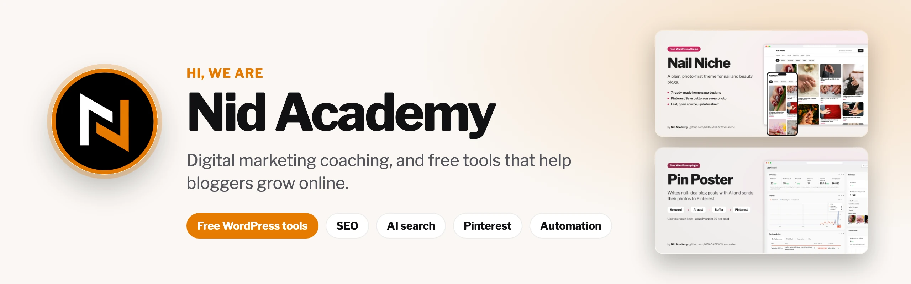

<picture>
  <source media="(prefers-color-scheme: dark)" srcset="assets/banner-dark.webp">
  <source media="(prefers-color-scheme: light)" srcset="assets/banner-light.webp">
  
</picture>

<p align="center">
  <a href="https://www.nidacademy.org"></a>
  <a href="https://www.youtube.com/@Nid.Academy"></a>
  <a href="https://www.instagram.com/nidacademy_/"></a>
  <a href="https://www.facebook.com/nidacademy1"></a>
  <a href="https://twitter.com/NidacademyAr"></a>
</p>

## Nid Academy

An online community from Morocco 🇲🇦 that teaches **digital marketing**: SEO, keyword research, AI, WordPress, Pinterest and automation. We are passionate about helping people grow their business online, and we share the tools we build for our own sites **for free**.

## 🛠 Free tools

<table>
  <tr>
    <td width="50%" valign="top">
      <a href="https://github.com/NIDACADEMY/nail-niche"></a>
      <h3><a href="https://github.com/NIDACADEMY/nail-niche">Nail Niche</a> · WordPress theme</h3>
      <p>A plain, photo-first theme for nail and beauty blogs: 7 home page designs, a Pinterest Save button on every photo, and automatic updates.</p>
      <a href="https://github.com/NIDACADEMY/nail-niche/releases/latest/download/nail-niche.zip"></a>
      <a href="https://github.com/NIDACADEMY/nail-niche/releases/latest"></a>
    </td>
    <td width="50%" valign="top">
      <a href="https://github.com/NIDACADEMY/pin-poster"></a>
      <h3><a href="https://github.com/NIDACADEMY/pin-poster">Pin Poster</a> · WordPress plugin</h3>
      <p>Writes nail-idea blog posts with AI, makes a Pinterest-size image for every look, and sends them to Pinterest through Buffer, by hand or on a schedule.</p>
      <a href="https://github.com/NIDACADEMY/pin-poster/releases/latest/download/pin-poster.zip"></a>
      <a href="https://github.com/NIDACADEMY/pin-poster/releases/latest"></a>
    </td>
  </tr>
</table>

## 📚 Free guides

| Guide | What you'll learn |
|---|---|
| [**Generative Engine Optimization (GEO)**](https://github.com/NIDACADEMY/Generative-Engine-Optimization) | How to fine-tune, profile and deploy generative AI models for speed, efficiency and better output. |
| [**SEO for Small Business**](https://github.com/NIDACADEMY/seo-for-small-business-2023) | The essential SEO steps to bring more search traffic to a small business website. |
| [**The SEO SEAL Method**](https://github.com/NIDACADEMY/seo-seal-method) | Seed → Expand → Analyze → Long-Tail: a data-driven keyword research framework, with spreadsheet templates. |

## 🎓 What we teach

```
SEO & keyword research  ·  AI for marketing  ·  WordPress  ·  Pinterest marketing  ·  Automation
```

## 🎥 Learn with us

New tutorials on how to grow online, step by step, and how to use the tools above:

<p>
  <a href="https://www.youtube.com/@Nid.Academy"></a>
  <a href="https://www.instagram.com/nidacademy_/"></a>
  <a href="https://www.facebook.com/nidacademy1"></a>
</p>

---

<p align="center"><sub>⭐ If a tool or guide helped you, star its repo: it helps others find it. · <a href="https://www.nidacademy.org">nidacademy.org</a></sub></p>
